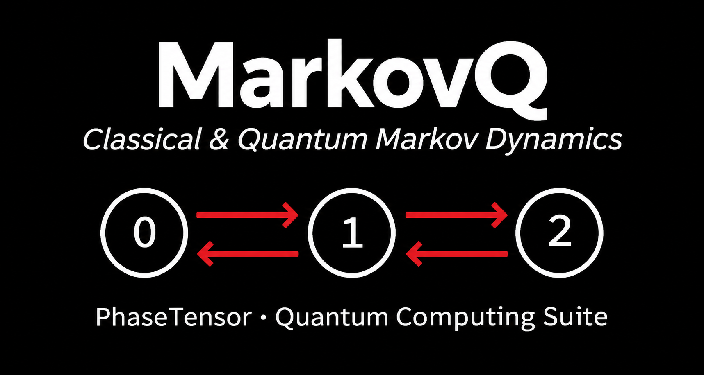

# MarkovQ

<p align="center"></p>

PhaseTensor’s scientific Python framework for classical and quantum stochastic dynamics. MarkovQ implements modules 01–25, from classical Markov processes and spectral graph operators to quantum walks, monitored detection, graph search, Lindblad evolution, noise channels, network ranking, partitioned simulation, circuit integration and scientific reporting.

## Install MarkovQ 0.1.0

```sh
python -m pip install markovq==0.1.0
```

```python
from markovq import absorption, line_walk

walk = line_walk(9, boundary="absorb")
result = absorption(walk.P)
print(dict(zip(result.transient, result.mean)))  # state 4: 16 steps
```

Install the independent reference solvers with `python -m pip install '.[references]' pytest` and run `python -m pytest`. Reproduce the benchmarks with `python -m benchmarks.foundations` and `python -m benchmarks.quantum`.

[Quantum API and scientific conventions](https://github.com/Phasetensor/MarkovQ/blob/v0.1.0/docs/quantum.md) · [Quantum benchmark results](https://github.com/Phasetensor/MarkovQ/blob/v0.1.0/docs/quantum-benchmarks.json)

[Scientific specifications and traceability](https://github.com/Phasetensor/MarkovQ/blob/v0.1.0/docs/foundations.md) · [Measured benchmark results](https://github.com/Phasetensor/MarkovQ/blob/v0.1.0/docs/benchmark-results.json) · [License](LICENSE)

[Numerical consolidation review](docs/consolidation-review.md) · [Precision and solver guidance](docs/numerical-stability.md) · [Scaling measurements](docs/scalability-benchmarks.md)

[Applied modules, case studies and benchmark index](docs/applied.md)

The 25 areas cover chains, classical walks, classification, recurrence, absorption, first passage, stationarity, mixing, continuous-time chains, Lévy models, graph Hamiltonians, spectral analysis, discrete and continuous quantum walks, Szegedy walks, monitored detection, quantum recurrence, quantum mixing, search, open dynamics, noise channels, biological networks, partitioned simulation, circuit adapters and scientific reporting. Hardware-adapter evidence uses simulators. [Final remediation](docs/final-remediation.md) · [Release notes](docs/release-notes.md).
