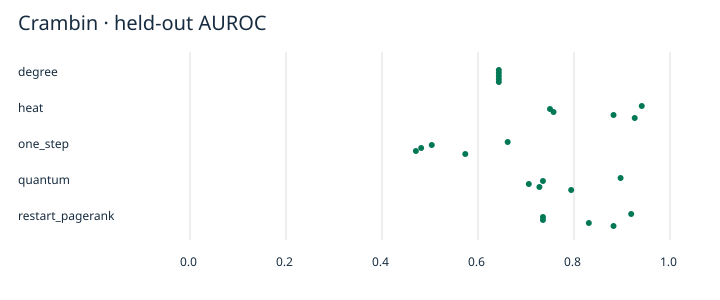

# Development acceptance for modules 01–25

Development version 0.1.0.dev0. The executable evidence is attached to the scientific validation workflow for each revision. The compatibility workflow exercises the core separately from Qiskit and QuTiP. The PhaseTensor integration job uses Python 3.12.

| Roadmap criteria | Evidence |
|---|---|
|1, 16. Functional areas and traceability|[01–12 specifications](foundations.md), [13–20 scientific acceptance](quantum-acceptance.md), [21–25 implementation and benchmark index](applied.md).|
|2, 4–6. Definitions and protocols|[Classical finite and infinite models](foundations.md) and [quantum API](quantum.md). The tests separate time-zero occupancy, monitored first returns, repeated measurements and terminal sampling.|
|3, 7, 8. Independent validation, Szegedy and physicality|[Consolidation review](consolidation-review.md) and reference tests using Qiskit and QuTiP. Repeated evolution, spectral phase residuals, trace, Hermiticity and positivity have explicit checks.|
|9–11. Benchmarks, biology and interoperability|[Benchmark index A–O](applied.md), [protein inputs](../benchmarks/data/README.md), [offline integration results](case-studies/phase-suite.json) and the six exported case studies.|
|12–15. Quality gates|Scientific workflow runs independent statement and branch gates, Ruff lint and formatting, Mypy and tests. Numerical compatibility runs the Linux/macOS matrix for Python 3.9–3.14. Consult the run attached to the exact revision for outcomes.|
|17, 18. Packaging|Scientific workflow builds wheel and sdist, runs strict Twine checks and installs the wheel into an isolated environment outside the repository.|
|19. Limitations|[Numerical stability](numerical-stability.md) and [applied limitations](applied.md). Additional independent datasets, real quantum hardware, multi-host throughput, GPU acceleration and cloud costs remain unmeasured.|

## Observed results

The crambin contact graph has 46 residues and 203 edges. On the five fixed seed selections, held-out AUROC ranges were 0.706–0.897 for CTQW, 0.735–0.919 for restart and 0.750–0.941 for heat diffusion. Degree scored 0.643. These ranges describe variation across seeds on one structure. They do not estimate generalization to other proteins.

Reproduce the figure with python -m benchmarks.applied_figure docs/case-studies/study-5.json. On the local macOS run, the 256-state kernel occupied 10,220 CSR bytes. Two processes took a median 1.047 seconds for 10,000 trajectories of length 16. Process startup dominates this small workload. The [raw results](applied-benchmarks.json) include single-process measurements and variability.

The PhaseTensor experiment allocated 10,000 simulated pilot and final shots through ShotWeave. Independent reference and distribution samples brought the total to 39,936. The sequential comparison for IIZ was inconclusive at tolerance 0.1. The position-level test measured total variation 0.124 under the specified synthetic readout. This evidence concerns a simulator with a known generating model.

Owner approval, release signing or tagging, PyPI publication and public installation checks belong to a subsequent release decision.
