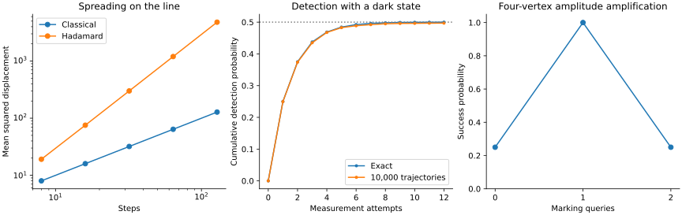

# Quantum dynamics, modules 13–20

Public imports use `from markovq import quantum as q`. These finite-state models use column kets, complex amplitudes and units with ℏ = 1. In contrast, the classical chain takes row distributions. A fresh measurement protocol must be specified whenever a time or probability of detection is reported.

## 13. Discrete-time coined walks

`q.cycle_walk(n, coin)` builds U = S(C ⊗ I) in coin-major order. Coin 0 moves left and coin 1 moves right on the cycle. The default Hadamard and custom unitary coins share this convention. `walk.evolve(ket, steps)` returns a ket and `walk.marginals(ket)` returns position and coin probabilities. On a general simple undirected graph, `q.graph_walk(A, coins)` uses a basis of directed arcs in row-major order and swaps the two endpoints after a local coin. Sorted neighbors define local port indices; the second marginal counts local port numbers, which have no universal spatial direction. Grover coins default to the degree-specific dimension.

`q.line_distribution(t)` evolves only the reachable interval and returns positions and probabilities. The default initial coin (1,i)/√2 produces a symmetric position law. Cost is O(t²) arithmetic and O(t) memory. Explicit finite-graph operators take O(d²) storage for Hilbert dimension d. Qiskit independently assembles the full three-qubit Hadamard-and-shift circuit on a four-cycle and compares every operator entry.

## 14. Continuous-time quantum walks

`q.continuous_walk(H, ket, t, method)` evolves exp(−itH)ψ. Obtain an adjacency or Laplacian generator from the classical/spectral module, or supply a Hermitian matrix in the appropriate energy units. Negative times implement reverse evolution. Methods are dense exponential, spectral diagonalization and Krylov exponential action. Dense methods use O(d³) arithmetic. Sparse action avoids constructing the propagator; runtime depends on the matrix and elapsed time. Analytical two-site Rabi oscillations check the sign of the imaginary amplitude as well as its modulus. Benchmark F compares three methods across six graph families at two times.

## 15. Szegedy walks

`q.szegedy(P, reverse=Q)` embeds row i of P in A as |i〉⊗Σⱼ√Pᵢⱼ|j〉. Column j of B is Σᵢ√Qⱼᵢ|i〉⊗|j〉. The default Q=P specifies the swap construction. An explicit second row kernel is accepted for a two-kernel walk. For stationary π of full support, a time-reversed kernel has Qⱼᵢ=πᵢPᵢⱼ/πⱼ. Select that model explicitly when the chain is nonreversible. The API returns A, B, both reflections, U=RᵦRₐ, D=A†B, and a coherent embedding of a supplied probability law. Singular values s strictly between 0 and 1 give conjugate eigenphases ±2 arccos(s) on the corresponding two-dimensional principal-angle planes. Endpoints and the orthogonal complement require separate multiplicity accounting. The implementation stores a dense n² by n² walk. Even modest n can exceed available memory.

## 16. Quantum first detection

`q.first_detection(U, ψ, Π, steps)` evolves first, then applies an ideal projective measurement. Index zero has unit survival and zero detections, even when the initial ket is already in the target. The output stores first-event mass, survival and the final unnormalized survivor. Its normalized conditional state exists only after a nonzero survival event. With K=(I−Π)U the n-th mass is ‖ΠUKⁿ⁻¹ψ‖². Cumulative mass plus survival equals one. Finite-horizon propagation takes O(Td²) after operator checks.

`q.eventual_detection` computes the dark subspace inside each unitary eigenspace using the kernel of the target projection. Its complement is bright. The squared norm of the initial bright component is the total detection probability. On the bright restriction, the discrete Lyapunov sum of survival probabilities gives the mean number of attempts conditional on eventual detection. A numerically zero bright component yields an undefined conditional mean. The tolerance is an absolute eigenphase chord and singular-value resolution. Very close phases and very weakly coupled targets can make dark classification and mean times sensitive to that tolerance.

## 17. Quantum recurrence

`q.recurrence(U, ψ, steps)` returns unmonitored return amplitudes aₙ, unmonitored occupancy |aₙ|², rank-one first-return amplitudes and the monitored distribution. The scalar renewal recursion uses fₙ=aₙ−Σⱼ₌₁ⁿ⁻¹ fⱼaₙ₋ⱼ and costs O(T²) in addition to propagation. The test suite independently obtains |fₙ|² by repeated measurement. Every result describes the given initial ket and sampling interval. Integer-line distributions up to a finite step count do not establish an infinite-time recurrence classification.

## 18. Quantum mixing

`q.quantum_mixing(U, ψ, T, positions)` returns instantaneous measured distributions at times 0 through T−1, their arithmetic mean, the finite-system limiting mean, and TV distance between the means. Position labels group orthogonal basis states. The limiting mean sums the probabilities of the projections of ψ onto distinct eigenspaces; it preserves interference within a degenerate eigenspace. The Schur decomposition costs O(d³) and successively sampling a dense evolution costs O(Td²). `q.dephased_mixing` applies a nonselective position measurement after each step with a specified probability, leaving coherences inside each position block intact. It uses O(Td³) dense work. At zero strength it recovers coherent propagation. At full strength the Hadamard qubit example loses its recurrent population oscillations.

## 19. Search

`q.discrete_search` applies a phase oracle on the marked basis states followed by the supplied walk step. `q.coined_search` marks all local ports of a marked vertex, and `q.szegedy_search` marks the first register before the two-reflection step. `q.amplitude_amplification` reflects about the prepared state. One iteration costs one marking query. Given a preparation unitary A, a synthesized reflection about A|0〉 may additionally require both A and A† per iteration. `q.continuous_search` uses H=−γA−Π and unit-strength analog oracle exposure t. Results give per-candidate probabilities, the best sampled index, query counts, analog durations, and one initial preparation and one final measurement per trial. The first maximizing candidate is returned. The expected_cost method estimates repeated preparations, final measurements, marking queries and analog oracle time for independent trials at one fixed candidate. Zero success requires infinitely many trials. The optimum is restricted to the supplied candidates. Dense powers cost O(d³ log k) per positive discrete candidate; the continuous implementation diagonalizes per candidate.

`q.classical_search` returns cumulative success for an observed weighted graph walk and for independent uniform inspections with replacement. Index k represents k transitions and k+1 vertex inspections including the initial vertex. The quantum benchmark uses ideal model costs. Compiling a walk, implementing the oracle, preparing the state, repeating trials and selecting candidate times incur separate costs.

## 20. Open quantum systems

`q.evolve_density(H, ρ₀, times, collapse, method)` solves a constant-coefficient Lindblad master equation. Times are elapsed from zero; multiple output times must increase strictly. Each L contributes LρL†−{L†L,ρ}/2. The Liouvillian uses column-major vectorization. The default exponential solution and an independent adaptive DOP853 solution return raw states, populations, l1 coherence, trace errors, Hermiticity residuals and the minimum eigenvalue of each Hermitian part. The diagnostic Hermitian part is used only for the eigenvalue calculation. Integration failures raise an exception. Compare time series and tighten tolerances when investigating numerical error.

`q.stochastic_walk(H, rates, ω)` interpolates between coherent motion and independent directed jumps through (1−ω)H and operators √(ωrᵢⱼ)|j〉〈i|. Rates use source rows and destination columns. Diagonal rates model local dephasing. The full local-jump limit reproduces classical two-state populations. The dense generator costs O(d⁴) storage and a dense exponential can cost O(d⁶) arithmetic. References include the analytical excited-state decay exp(−t), a driven complex-Hamiltonian QuTiP calculation and consistency of two numerical solvers. The implementation covers finite-dimensional, time-independent Markovian open dynamics.

## Numerical results

The figure reads the committed numerical record. Recreate it with Matplotlib installed using `python -m benchmarks.quantum_figure`.

## Verification and references

Run the full reference suite with `python -m pip install '.[references]' pytest` and `python -m pytest`. Reproduce the statistical and numerical benchmark with `python -m benchmarks.quantum`. The tests are in tests/test_quantum.py and tests/test_quantum_references.py. The stored numerical results identify NumPy, SciPy and Python versions, the Monte Carlo seed, a standard error, graph sizes, candidate times and timing measurements.

- [Szegedy, Quantum speed-up of Markov chain based algorithms](https://doi.org/10.1109/FOCS.2004.53)
- [Friedman, Kessler and Barkai, Quantum walks: The first detected passage time problem](https://doi.org/10.1103/PhysRevE.95.032141)
- [Childs and Goldstone, Spatial search by quantum walk](https://doi.org/10.1103/PhysRevA.70.022314)
- [Whitfield, Rodríguez-Rosario and Aspuru-Guzik, Quantum stochastic walks](https://doi.org/10.1103/PhysRevA.81.022323)
- [QuTiP master-equation solver](https://qutip.readthedocs.io/en/qutip-5.2.x/apidoc/solver.html)
